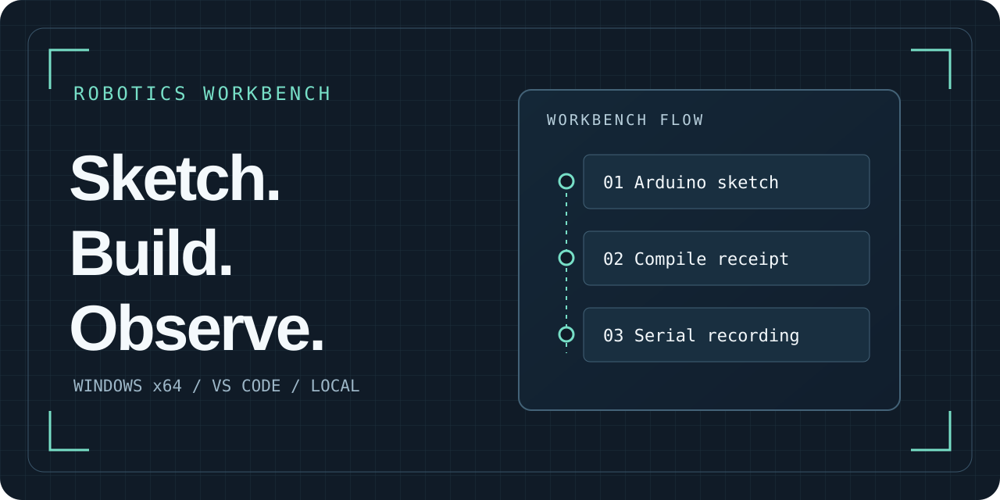
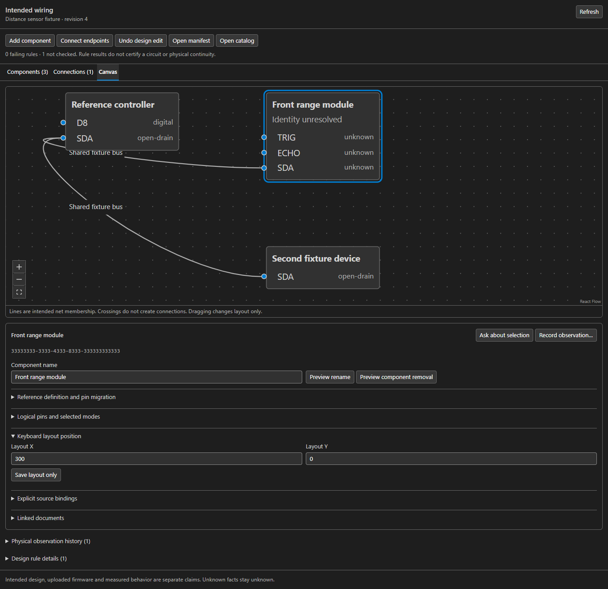
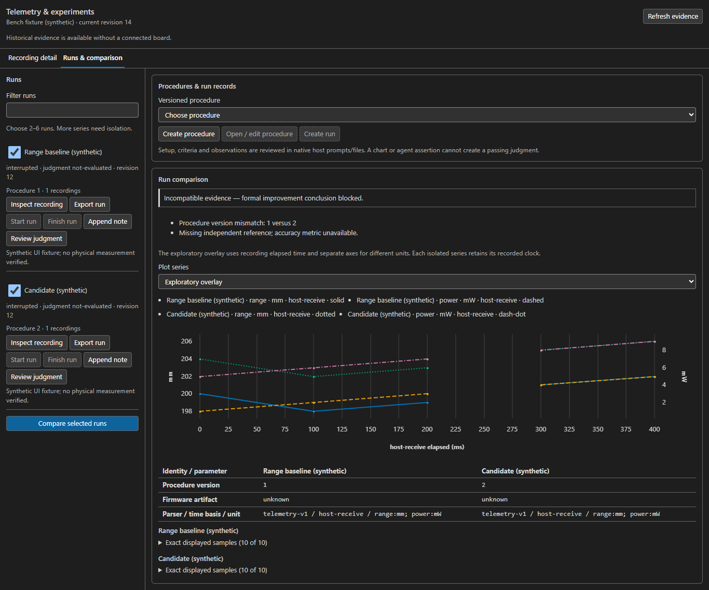

# Robotics Workbench



**A local VS Code workbench for Arduino projects, from the sketch to the recorded evidence.**

[](https://github.com/Huzaifa-Shahid-6ll/robotics-workbench/releases/tag/v0.1.0)
[](https://github.com/Huzaifa-Shahid-6ll/robotics-workbench/actions/workflows/ci.yml)
[](LICENSE)

[Quickstart](docs/quickstart.md) · [Documentation](https://huzaifa-shahid-6ll.github.io/robotics-workbench/) · [Releases](https://github.com/Huzaifa-Shahid-6ll/robotics-workbench/releases) · [Discussions](https://github.com/Huzaifa-Shahid-6ll/robotics-workbench/discussions) · [Roadmap](ROADMAP.md)

## Start with an existing sketch

1. Download the Windows VSIX and its checksum from the [preview release](https://github.com/Huzaifa-Shahid-6ll/robotics-workbench/releases/tag/v0.1.0).
2. In VS Code, run **Extensions: Install from VSIX…** and select the file.
3. Open the folder with your Arduino sketch. Run **Robotics: Import Existing Sketch**, then **Robotics: Check Tools**.
4. Run **Robotics: Compile**. You can edit and compile with the installed toolchain while the board is disconnected.

The Windows x64 preview uses local Node 24.18.0 and was tested with VS Code 1.144.0. See the [quickstart](docs/quickstart.md) for the Arduino CLI, board support, and the separate upload confirmation.

## Inside the workbench



*Intended wiring with a synthetic distance-sensor fixture. The connection table offers the same editing path by keyboard.*

| Workflow | What you can do |
| --- | --- |
| **Sketch and build** | Keep ordinary Arduino files, compile a saved snapshot, and see current diagnostics in VS Code. |
| **Agent and review** | Use local Codex or OpenCode, inspect supplied context, and compare source changes in a native diff. |
| **Wire and document** | Manage parts and intended connections, cite an exact document version, and hand off to KiCad or scripted CAD. |
| **Record and compare** | Retain raw serial data, inspect gaps and clock bases, compare runs, and recover interrupted operations. |

<details>
<summary>See a synthetic experiment comparison</summary>



The plot labels its clock, units, and patterns. Exact sample tables and the recorded run identities are available below the chart.

</details>

## Build from source

From a local Windows x64 checkout with Node 24.18.0 and npm 11:

```powershell
npm ci --ignore-scripts
npm run check
npm test
npm run launch
```

The last command opens an Extension Development Host. See the [contributor guide](CONTRIBUTING.md) for packaging and verification, the [architecture map](docs/repository-and-module-map.md) for the source layout, or the [workbench guide](docs/workbench-guide.md) for full operator notes.

## Preview scope

The build, upload, and physical observation are separate records. Uploads require an explicit device and exact artifact. Current live provider, physical hardware, and full native accessibility acceptance remain open. [UI coverage](ui-work/2026-11-07-ui-pass/screen-coverage.json) · [Public verification scope](verification/README.md)

Report a reproducible problem in [Issues](https://github.com/Huzaifa-Shahid-6ll/robotics-workbench/issues/new/choose), ask a usage question in [Discussions](https://github.com/Huzaifa-Shahid-6ll/robotics-workbench/discussions), or report a vulnerability privately through [Security](https://github.com/Huzaifa-Shahid-6ll/robotics-workbench/security/advisories/new).
