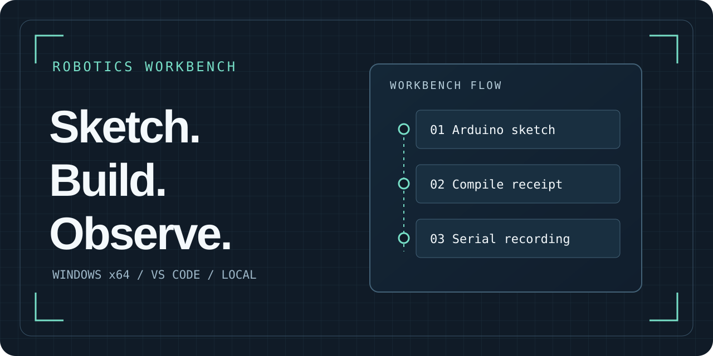

## An Arduino workbench inside VS Code

Open an existing sketch, compile saved source, and inspect intended wiring, tool results, and recordings in the same workspace. The Windows x64 preview is available as a VSIX.

[Install the preview](https://github.com/Huzaifa-Shahid-6ll/robotics-workbench/releases/tag/v0.1.0) · [Quickstart](https://github.com/Huzaifa-Shahid-6ll/robotics-workbench/blob/main/docs/quickstart.md) · [View the repository](https://github.com/Huzaifa-Shahid-6ll/robotics-workbench)

## Find your next step

| Goal | Guide |
| --- | --- |
| Install, compile, and choose a device | [Windows quickstart](https://github.com/Huzaifa-Shahid-6ll/robotics-workbench/blob/main/docs/quickstart.md) |
| Configure optional providers, KiCad, or CAD | [Installation and troubleshooting](https://github.com/Huzaifa-Shahid-6ll/robotics-workbench/blob/main/docs/personal-installation-and-troubleshooting.md) |
| Build from source or contribute | [Contributor guide](https://github.com/Huzaifa-Shahid-6ll/robotics-workbench/blob/main/CONTRIBUTING.md) |
| See what's planned | [Roadmap](https://github.com/Huzaifa-Shahid-6ll/robotics-workbench/blob/main/ROADMAP.md) |
| Get help | [Discussions](https://github.com/Huzaifa-Shahid-6ll/robotics-workbench/discussions) |

The preview runs locally. Build results, upload receipts, and physical observations remain separate evidence.
